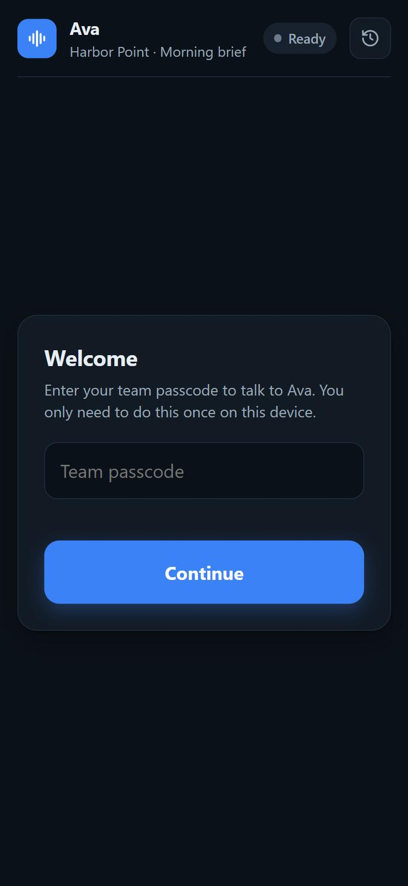
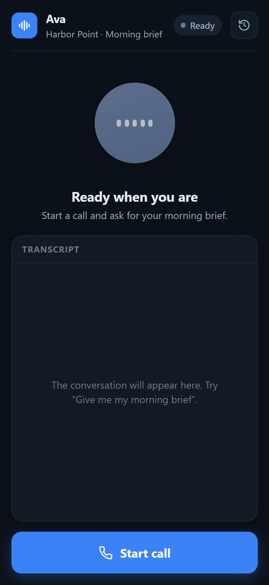
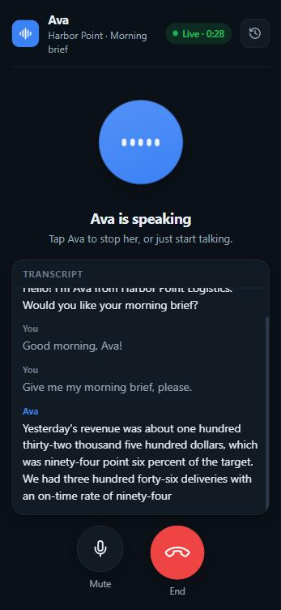
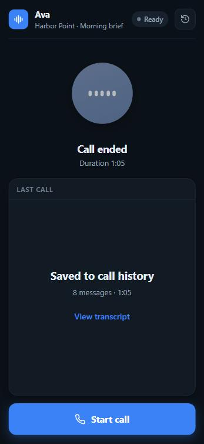
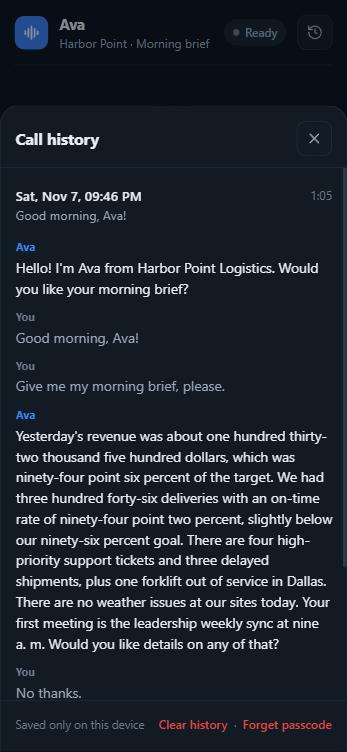
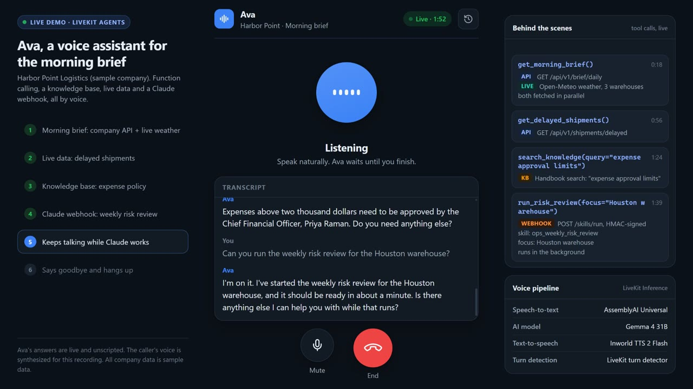
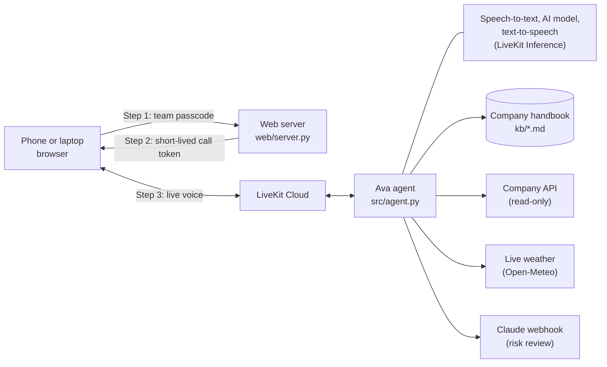
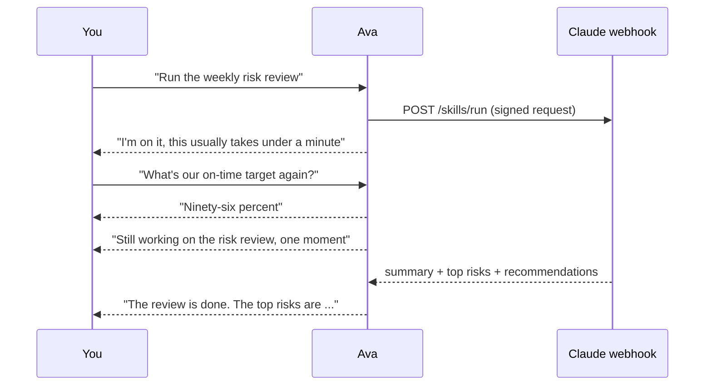

# Ava: a voice assistant for your morning brief

Ava is a voice assistant your team can **talk to from a phone or laptop browser**.
Ask for your morning brief on the way to work, ask a question about the company, or ask
Ava to run a deeper analysis. She answers out loud, in real time.

It is built with **[LiveKit Agents](https://docs.livekit.io/agents/)** (Python) and
**LiveKit Cloud**. This is a working prototype for a made-up company, **Harbor Point
Logistics**, a freight and warehousing business. All company data in this repo is sample
data.

<p>
  
  
  
  
  
</p>

*Left to right: enter the team passcode once, start a call, Ava reads the brief with a live
transcript, the call ends, and every call is saved in a call history on the device.*

---

## Demo video (3 minutes)

[](docs/demo/ava-demo.mp4)

**[Watch the demo video](docs/demo/ava-demo.mp4)** (MP4, 3 min, with sound). One real call, start to finish:

| Time | What happens | What it shows |
|---|---|---|
| 0:16 | "Can you give me my morning brief?" | Function calling: company API + live weather, fetched in parallel |
| 0:54 | "Which shipments are delayed, and why?" | Live data from the company system |
| 1:22 | "Who needs to approve an expense of about three thousand dollars?" | Knowledge base search |
| 1:38 | "Can you run the weekly risk review for the Houston warehouse?" | Claude webhook, running in the background |
| 1:57 | "While that runs, what time is it in Phoenix?" | Ava keeps talking while Claude works, then reads the review |
| 2:36 | "That's everything for now, thank you Ava!" | Ava says goodbye and hangs up; the call is saved to the history |

The left panel lists the steps. The right panel shows **each tool call as it happens**, so
you can see what Ava does behind each answer.

About the recording: Ava's answers are live and unscripted (real speech-to-text, AI model,
tools and voice). The caller's voice was generated with text-to-speech so the call can be
replayed. It was recorded on a laptop with the agent running locally; one 11-second pause
before the Phoenix answer (a slow model response) was shortened to 4 seconds, and the
stand-in Claude was set to take 25 seconds (`MOCK_CLAUDE_DELAY=25`). Nothing else is edited.

---

## What can Ava do?

| You say | What Ava does |
|---|---|
| "Give me my morning brief" | Reads yesterday's revenue, on-time deliveries, urgent tickets, delayed shipments, **live weather at the warehouses** and your first meeting |
| "Who approves an expense of three thousand dollars?" | Looks it up in the company handbook (knowledge base) |
| "Which shipments are delayed?" | Gets live data from the company system |
| "Could the weather delay deliveries today?" | Checks **real, live weather** for all three warehouses |
| "What time is it in Phoenix?" | Gets the real local time |
| "Run the weekly risk review" | Asks the company's **Claude** setup to run an analysis, keeps you posted while it works, then reads you the result |
| "Close all the tickets" | Politely says no: Ava can only **read**, never change anything |
| "No thanks, that's all" | Says goodbye and **hangs up by herself** |

On the call page you can also **mute your mic**, **tap Ava to stop her talking**, and open
the **call history** to re-read past calls.

---

## How it works



In plain words:

1. You open the call page and type the **team passcode** (only once per device).
2. The web server checks the passcode and gives your browser a **call token** that expires
   after 15 minutes. It also tells LiveKit to send Ava into the call.
3. Your voice travels through **LiveKit Cloud** to the **Ava agent**, a Python program that
   runs on your own computer or server.
4. Ava turns your speech into text, decides what to do (often by calling a **tool**, see
   below), writes an answer, and speaks it back.

### The voice pipeline

All three models run through **LiveKit Inference**, so no extra accounts or API keys are needed.

| Step | Model | Why |
|---|---|---|
| Hear (speech-to-text) | AssemblyAI Universal | Accurate, and we teach it company words like "Harbor Point" |
| Think (AI model) | Gemma 4 31B, hosted by LiveKit | Fast, good at calling tools, tuned for voice |
| Speak (text-to-speech) | Inworld TTS 2 Flash, voice "Elizabeth" | Professional tone. The Flash model starts each sentence quickly, so there are no long pauses mid-answer (we measured the pauses for each voice and model) |
| Know when you're done talking | LiveKit turn detector | Ava doesn't cut you off mid-sentence |

---

## Function calling (tools)

**Function calling** means the AI model can decide to run a piece of our code (a "tool") to
get real information, instead of guessing. For example, when you ask for the weather, the
model calls `get_weather("Houston")`, our code fetches the real weather, and the model reads
the result back to you.

Ava has **11 tools**:

| Tool | What it does | Where the data comes from |
|---|---|---|
| `search_knowledge` | Searches the company handbook | `kb/*.md` files in this repo |
| `get_morning_brief` | Daily numbers + warehouse weather, fetched **at the same time** | Company API + Open-Meteo |
| `get_sales_summary` | Revenue for yesterday, the week or the month | Company API |
| `get_support_tickets` | Open customer tickets | Company API |
| `get_delayed_shipments` | Shipments that are late right now, and why | Company API |
| `get_todays_meetings` | Today's leadership calendar | Company API |
| `get_weather` | Live weather for any city | Open-Meteo (free, no key) |
| `get_warehouse_weather` | Live weather and travel risks (storm, ice, fog, heavy rain, strong wind) at Dallas, Houston and Phoenix | Open-Meteo |
| `get_local_time` | Current date and time anywhere | Built in |
| `run_risk_review` | Asks Claude to run the weekly risk review (see next section) | Claude webhook |
| `end_call` | Says goodbye and hangs up | LiveKit |

This is what real tool calls look like in the agent debugger (tool results shortened):

```text
You:   Who has to approve an expense of about three thousand dollars?
tool:  search_knowledge({"query": "expense approval limits"})
       -> [Company policies / Expenses] ... Expenses above 2,000 dollars need the Chief Financial Officer, Priya Raman ...
Ava:   Expenses over two thousand dollars need to be approved by the Chief Financial Officer, Priya Raman.

You:   Could weather delay any of our deliveries today?
tool:  get_warehouse_weather()
       -> Dallas: overcast, 60F, risks none | Houston: overcast, 72F, risks none | Phoenix: clear sky, 69F, risks none
Ava:   No, there are no travel risks at our Dallas, Houston, or Phoenix sites, so weather shouldn't delay any deliveries today.
```

**Ava never invents numbers.** The instructions in `src/prompt.md` tell her to use only what
the tools return. If a tool fails, she says so in one sentence.

**You can see every tool call.** Each one is written to the agent log (`tools executed: ...`)
and sent to the call page as a small message on the `ava.tools` topic. The "Behind the
scenes" panel in the demo video is built from these messages.

---

## The Claude webhook

### What it is for

Some questions need a deeper analysis than a quick voice answer, for example *"what should
we worry about this week?"*. The company already has its own **Claude** setup that can read
its data and run approved **skills** (fixed, pre-written jobs).

So Ava doesn't do that analysis herself. She **sends a webhook** (an HTTP request) to the
Claude setup, Claude runs **one predefined, read-only skill**, and sends the result back.

**Use case in this project: the weekly operations risk review.** Claude looks at
shipments, support tickets and sales, and returns a summary, the top risks and what to do
about them.

### How a call with Claude feels



- Ava **tells you right away** that she's working on it.
- You can **keep talking** to her while Claude works. The tool runs in the background
  (an "async tool" in LiveKit).
- If it takes a while, she says a short **"still working"** line during quiet moments.
- If Claude fails or takes longer than 90 seconds, she tells you plainly.

The request Ava sends:

```http
POST /skills/run
Content-Type: application/json
X-Timestamp: 1794060000
X-Signature: <HMAC-SHA256 of "timestamp.body" with the shared secret>

{ "request_id": "6f1c...", "skill": "ops_weekly_risk_review", "input": { "focus": "Houston warehouse" } }
```

The answer Claude sends back:

```json
{
  "request_id": "6f1c...",
  "status": "completed",
  "result": {
    "summary": "Operations are mostly healthy, but on-time delivery dipped below 96 percent on two days ...",
    "top_risks": ["Houston cold storage is at 91 percent capacity ...", "..."],
    "recommendations": ["Reserve overflow cold storage for Brightwell ...", "..."]
  }
}
```

### Why there is a mock instead of the real Claude

The real Claude setup belongs to the company and runs inside their own systems with
access to their data. It isn't public, so it can't live in this repo. Instead the repo includes
**`mocks/claude_webhook.py`**, a small stand-in server that behaves **exactly like the real
one**:

- same address format, same request and answer format,
- it **checks the signature** and rejects anything unsigned or replayed,
- it only accepts the one approved skill,
- it **waits 15 seconds** like a real Claude run, so you can hear the "working on it" flow.

**To connect the real Claude setup, no code changes are needed.** Set two settings:
`CLAUDE_WEBHOOK_URL` (their address) and `CLAUDE_WEBHOOK_SECRET` (the shared secret).

### Why the voice agent doesn't call Claude directly

- **Speed:** a deep analysis takes 10 to 60 seconds. Ava uses a small, fast model so
  normal answers come back in about a second.
- **Safety:** Claude runs inside the company's own environment with its own access rules.
  Ava can only trigger **one fixed, read-only skill**. She can't ask Claude to do anything else.
- **Separation:** the company can change or improve the skill on their side without
  touching the voice agent.

---

## Company data (mock API)

The company system is also replaced by a mock, **`mocks/internal_api.py`**, which serves
realistic sample data (sales, tickets, delayed shipments, meetings). It follows the same
rules as a real one: it needs a token, and it **only allows reading** (any attempt to change
data is refused).

On Ava's side (`src/internal_api.py`) the safety rules are in the code, not just the prompt:
only GET requests, only a fixed list of allowed addresses, a 5-second timeout, and a
read-only token. To use the real company API, change `INTERNAL_API_URL` and
`INTERNAL_API_TOKEN`, and adjust the paths if they differ.

## Knowledge base

The handbook lives in **`kb/`** as simple Markdown files: company info, team and contacts,
services and customers, policies, FAQ. Ava searches it with a fast keyword search and
answers **only** from what she finds. If it isn't there, she says so and suggests who to ask.

To update it, edit or add `.md` files (use `## ` headings to split topics) and restart the agent.

---

## Built for real calls

Ava is meant to be used from a phone, often on the move, so a few things are handled on purpose:

- **Network drops don't end the call.** If the connection drops for a moment, the browser
  reconnects by itself. Ava waits up to 20 seconds for the caller to come back
  (`REJOIN_GRACE` in `src/agent.py`) instead of hanging up, and the call page shows
  "Reconnecting…" meanwhile.
- **Hanging up is instant.** When Ava says goodbye, the call ends for the caller about a
  second later, not after the agent has finished its clean-up.
- **Results are never lost.** If the Claude risk review finishes while you're asking
  something else, Ava answers your question first and then tells you the review is ready.

---

## Safety and privacy

- **Read-only:** Ava can't create, change or delete anything in company systems.
- **Passcode:** the call page needs a team passcode. After 8 wrong tries from the same network address, it is blocked for 10 minutes.
- **Short-lived access:** each call gets its own private room and a token that expires in 15 minutes.
- **Signed webhooks:** every Claude request is signed, so the Claude side knows it really came from Ava.
- **Secrets stay private:** keys and passwords live in `.env.local`, which is never committed.
- **Weather lookups** send only a city name. No company data leaves the agent.
- **Call history** is stored only in the user's own browser, not on the server.

---

## Project structure

```text
LiveKit-Agent/
├── src/
│   ├── agent.py          # Ava: voice pipeline + all tools
│   ├── prompt.md         # Ava's instructions (edit this to change how she behaves)
│   ├── knowledge.py      # handbook search
│   ├── internal_api.py   # read-only company API client
│   ├── claude_skill.py   # signed Claude webhook client
│   └── live_data.py      # live weather and time
├── kb/                   # company handbook (Markdown)
├── web/
│   ├── index.html        # the call page
│   └── server.py         # passcode check + call tokens
├── mocks/
│   ├── internal_api.py   # stand-in for the company API
│   └── claude_webhook.py # stand-in for the Claude setup
├── deploy/               # Ubuntu server setup: systemd services, HTTPS (Caddy), deploy script
├── docs/
│   ├── screenshots/      # images used in this README
│   └── demo/             # demo video
├── scenarios.yaml        # automated conversation tests
├── RUNBOOK.md            # how to run, change and fix things
└── .env.example          # list of all settings
```

---

## Run it yourself

**You need:** Python 3.10+, [uv](https://docs.astral.sh/uv/), the
[LiveKit CLI](https://docs.livekit.io/intro/basics/cli/) and a free
[LiveKit Cloud](https://cloud.livekit.io) account.

1. Install and sign in:
   ```bash
   uv sync
   lk cloud auth
   ```
2. Create your settings file: copy `.env.example` to `.env.local`, then fill it in.
   - `lk app env --write --destination .env.local` fills in the LiveKit keys for you.
   - For `INTERNAL_API_TOKEN`, `CLAUDE_WEBHOOK_SECRET` and `WEB_PASSCODE`, use any long random
     text, for example from `python -c "import secrets; print(secrets.token_hex(24))"`.
   - Set `LIVEKIT_AGENT_DEPLOYMENT=dev-local` for local testing.
3. Start the four parts, each in its own terminal:
   ```bash
   uv run python mocks/internal_api.py      # sample company API
   uv run python mocks/claude_webhook.py    # sample Claude setup
   lk agent dev --deployment dev-local      # Ava
   uv run python web/server.py              # the call page
   ```
4. Open **http://localhost:8090**, enter your `WEB_PASSCODE`, allow the microphone and say
   *"Give me my morning brief"*.

Phones need **HTTPS** to use the microphone, so phone testing works once the app is on a
server with a domain.

## Changing things

| I want to change... | Edit |
|---|---|
| What Ava says and how | `src/prompt.md` |
| Ava's voice | `tts=` in `src/agent.py` ([voice list](https://docs.livekit.io/agents/models/tts/)) |
| The goodbye line | `GOODBYE` in `src/agent.py` |
| What Ava knows | files in `kb/` |
| Tools | `@function_tool` methods in `src/agent.py` |
| The passcode | `WEB_PASSCODE` in `.env.local` |

Then restart the agent. More detail is in **[RUNBOOK.md](RUNBOOK.md)**.

## Testing

- **Quick check without speaking:** the agent debugger shows every tool call and reply.
  ```bash
  lk agent debugger start
  lk agent debugger say "Give me my morning brief"
  lk agent debugger stop
  ```
- **Conversation tests:** `scenarios.yaml` has 10 scripted conversations (handbook answers,
  "I don't know" answers, the morning brief, refusing to change data, the Claude flow and
  live weather). Run them with `lk agent simulate text --scenarios scenarios.yaml`.
- **GitHub Actions:** every push runs the **Ruff** code checks. **Simulations** runs the
  scenarios in the cloud (with the mock servers) when you start it from the Actions tab; it
  needs the `LIVEKIT_URL`, `LIVEKIT_API_KEY` and `LIVEKIT_API_SECRET` repository secrets.

## What's next

- Deploy to an Ubuntu server so Ava keeps running after a restart. The scripts are ready in
  `deploy/` (systemd services + HTTPS with Caddy); see [RUNBOOK.md](RUNBOOK.md#server-ubuntu).
- Connect the real company API and the real Claude webhook (settings only).
- Replace the sample handbook with real documents.

---

Built on LiveKit's [agent-starter-python](https://github.com/livekit-examples/agent-starter-python)
template (MIT License).
